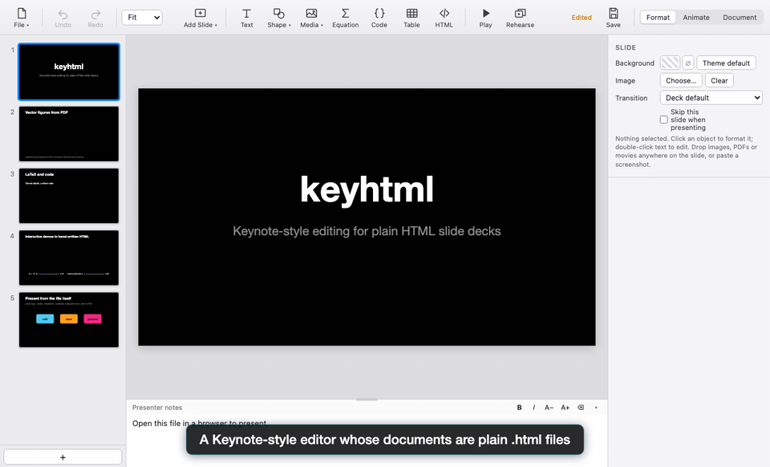

# keyhtml

[](https://github.com/lgbouma/keyhtml/actions/workflows/ci.yml)

A Keynote-style slide editor whose documents are plain, self-contained `.html` files.



* **Keynote-style editing.** Drag, snap, resize, rotate. Rich text, shapes, tables, groups, builds, undo.
* **Vector PDF figures.** Drop a matplotlib PDF: it becomes an SVG, sharp on any projector.
* **LaTeX and code.** `$E = mc^2$` in any text box; highlighted code blocks. Rendered at edit time, so the saved deck needs no library.
* **LLM-compatible.** The deck is readable HTML. An LLM can write, revise or diff your slides.
* **Interactive demos.** Hand-written HTML blocks and custom JS put sliders and live plots on a slide, with a live preview in the editor.
* **Movies.** Drop an `.mp4` or `.webm`: autoplay, loop, controls.
* **Imports HTML decks.** `<section class="slide">`s become editable slides; their CSS and JS are kept.
* **Present from the file.** Open the `.html` in a browser: arrow keys, builds, presenter notes and timer, print to PDF.

## Install and run

Requirements: Python ≥ 3.9 and a Chromium or WebKit browser (Chrome, Safari, Edge, Arc…). PDF conversion
needs **PyMuPDF** (`pip install pymupdf`); alternatively `pdftocairo` (poppler), `mutool`, `inkscape` or
`pdf2svg` on the PATH.

```bash
cd keyhtml
uv pip install -e .            # or: pip install -e .   (installs the `keyhtml` command)
keyhtml talk.html              # creates talk.html if it does not exist, opens the editor in your browser
# equivalently, without installing:
python -m keyhtml talk.html
```

Options: `--root DIR` (directory the editor may see; default: the deck's directory), `--port N`
(default 8765), `--no-browser`. Everything runs on `127.0.0.1` only. The server process is the editor's
file backend; leave it running while you edit, Ctrl-C to stop. Saving is automatic (toggle in the
Document tab); a `.bak` of the previous version is kept next to the deck.

To present, you do not need the server: open `talk.html` directly (double-click, or `open talk.html`).
`File ▸ Export Standalone HTML` writes `talk_standalone.html` with every asset embedded as a data URI, for
carrying a single file to another machine.

Assets (images, SVGs made from PDFs, movies) live in a sibling folder `<deck>_assets/`.

Everything else, from shortcuts to the file format and the player's JavaScript hooks: [docs/manual.md](docs/manual.md).
